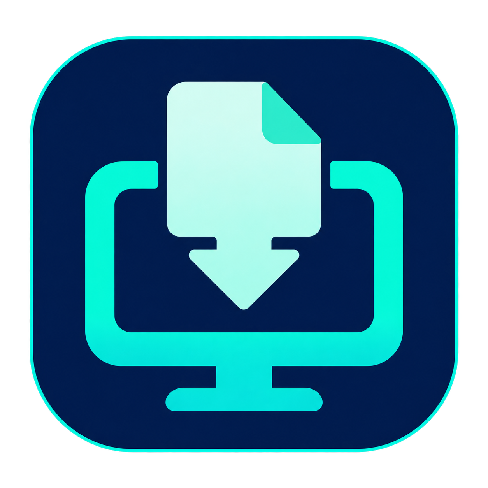

# OnDesk



[](LICENSE)
[](https://github.com/Mesteriis/OnDesk/releases/latest)

Открытая утилита для передачи файлов с Android на Mac в локальной сети.
На Mac живёт в строке меню. На Android выбирается в меню **Поделиться**.

## Возможности

- Однократное сопряжение по QR-коду, TLS с закреплением сертификата Mac.
- Несколько файлов за одну отправку; скриншоты — через «Поделиться».
- Постоянная очередь на телефоне, автоматические повторы и продолжение с
  подтверждённого блока. Размеры и смещения — 64-битные, блок — до 4 МиБ.
- Проверка SHA-256, защита от перезаписи, повторяемое подтверждение сохранения.
- Папки для изображений, видео, аудио, документов, архивов и прочих файлов.
- Отзыв доступа телефонов и запуск при входе в настройках Mac.

Поддержка: **macOS 27**, **Android 16–17**. Файлы передаются Android → Mac; Mac также может запросить запуск камеры телефона.
Устройства должны находиться в одной доступной локальной сети; гостевая сеть
с изоляцией клиентов может препятствовать подключению. Спящий Mac ждёт пробуждения.

## Сборка

### Mac

Нужны Xcode 27 и Command Line Tools.

```sh
./scripts/build-macos.sh
# Результат: build/OnDesk.app
open build/OnDesk.app
```

Для оптимизированной сборки: `./scripts/build-macos.sh release`.
Скрипт подписывает приложение локальной ad-hoc подписью. Для постоянного использования
скопируйте `.app` в Applications; запуск при входе включается в настройках OnDesk.
Первый запуск показывает настройки; далее приложение запускается в строке меню.
`open build/OnDesk.app --args --settings` открывает настройки при новом запуске процесса.

### Android

Нужны JDK 17 и Android SDK с платформой API 37. Укажите SDK через `ANDROID_HOME`
или локальный, не включаемый в Git файл `android/local.properties` (`sdk.dir=...`).
Gradle 9.7.1 закреплён в Wrapper; зависимости закреплены в Gradle-файлах.

```sh
cd android
./gradlew :app:assembleDebug
# Результат: app/build/outputs/apk/debug/app-debug.apk
```

Для установки на выбранный вами телефон: `adb -s SERIAL install -r app-debug.apk`.
Это устанавливает/обновляет разработческую сборку, сохраняя данные при совместимой подписи.
Удаление приложения или очистка его данных удаляют очередь и сопряжение.

## Использование

1. Запустите OnDesk на Mac, разрешите локальную сеть и доступ к выбранной папке,
   если macOS попросит. В настройках выберите **Сопрячь телефон**.
2. На Android откройте OnDesk → **Сканировать QR-код**. Разрешения камеры,
   локальной сети (Android 17) и уведомлений запрашиваются при настройке.
3. Поделитесь файлом, скриншотом или ссылкой в OnDesk. Главный экран приложения
   не открывается: исходный экран остаётся виден, после копирования появляется
   краткое подтверждение постановки в очередь. Передача на Mac продолжается в фоне.
4. Mac автоматически сохранит файлы в папки категорий. По умолчанию это
   `~/Downloads/OnDesk/`; существующие имена получают суффикс `(1)`, `(2)` и т. д.

Код сопряжения одноразовый, действует пять минут. Секреты телефона и TLS-ключ Mac
хранятся в Keychain; Android защищает сохранённое сопряжение ключом Android Keystore.
При смене Mac приложение спрашивает, можно ли отправить уже накопленную очередь
новому получателю. Отозванный доступ требует нового сопряжения.

## Очередь и восстановление

Копия файла остаётся на телефоне до окончательного подтверждения Mac. Очередь
не истекает автоматически. Для больших файлов нужно достаточно памяти телефона.
Android может задерживать фоновые задачи; длительная передача сопровождается
системным уведомлением. Повторы запускаются через WorkManager; периодическая
страхующая задача выполняется с интервалом не менее 15 минут по расписанию Android.
После принудительной остановки приложения пользователем Android возобновляет его
фоновую работу только после следующего открытия.

При недоступной папке или нехватке места на Mac файл остаётся в очереди.
Исправьте причину и повторите отправку. При повреждении копии или несовместимости
передачи OnDesk показывает ошибку; удаление из очереди требует подтверждения.
Оно не удаляет исходник телефона или уже сохранённый файл на Mac.

Прерванные данные и квитанции Mac находятся в Application Support/OnDesk/transfers.
Не удаляйте их во время работы. Они необходимы для продолжения и защиты от дубликатов;
автоматической очистки незавершённых передач в v1 нет.

## Проверки

```sh
cd macos && swift test
cd ../android && ./gradlew :app:testDebugUnitTest :app:lintDebug
```

Сквозной тестовый приёмник `OnDeskTestServer` слушает только loopback и использует
временные учётные данные, не обращаясь к пользовательскому Keychain.
Тесты Android из `src/androidTest` обслуживают только синтетические данные;
тестовый ContentProvider входит в отдельный instrumentation APK, а не в OnDesk APK.
См. [протокол](protocol/README.md), [результаты проверки](docs/VALIDATION.md)
и [журнал решений](docs/IMPLEMENTATION.md).

## Иконки

Исходный PNG пользователя сохранён в `assets/source/OnDesk.png`.
`./scripts/generate-icons.sh` воспроизводит размеры без изменения рисунка:

- Mac: 16/32/128/256/512 pt в 1×/2×, `.iconset`, `.icns`, `AppIcon.appiconset`.
- Android: launcher/round mdpi–xxxhdpi, адаптивная и монохромная версии,
  отдельная белая иконка уведомления; 512 px PNG для дополнительных материалов.
- Строка меню Mac: собственный монохромный template-знак документа и монитора.

ICNS включён в `.app` через `CFBundleIconFile`; Android Manifest ссылается на
`ic_launcher` и `ic_launcher_round`, адаптивная иконка содержит `monochrome`.

Папки назначения Mac должны поддерживать hard links (например, APFS): это нужно
для публикации файла без перезаписи и восстановления после сбоя. Папки на FAT/exFAT
и некоторые сетевые назначения не поддерживаются; выберите локальную APFS-папку.
Ожидающий файл можно удалить во время другой передачи. Для удаления текущего
отправляемого файла сначала дождитесь окончания передачи или остановите её уведомлением.

## Быстрые действия Android (0.2.0)

Долгое нажатие на значок OnDesk открывает **Скриншот → Mac** и **Камера → Mac**.
Если приложение жестов поддерживает шорткаты, выберите действия OnDesk в его списке.
Если доступен выбор activity, используйте `app.ondesk.ScreenshotShortcutActivity`
или `app.ondesk.CameraShortcutActivity`. Действия принимают только запуск; путь файла,
получателя и токен через внешний Intent передать нельзя.

В OnDesk → **Быстрые действия** вручную включите **OnDesk — скриншот на Mac**
в специальных возможностях Android. Служба получает изображение текущего экрана
по запуску действия, без постоянной записи, событий интерфейса или доступа к дереву
окон. Запросы к ней внутри приложения передаются непубличным receiver. Системный
доступ можно отозвать там же. Заблокированный телефон и защищённые экраны не снимаются.
Android может потребовать разрешить ограниченные настройки для установленного APK;
это выполняет владелец телефона вручную.

Камера открывается через системный capture intent: сделайте фото и подтвердите его,
если камера показывает подтверждение. Отмена не добавляет файл. Результат сохраняется
в частном каталоге приложения и включается в постоянную очередь с SHA-256; отдельного
меню «Поделиться» нет. Не закрывайте экран сохранения до подтверждения постановки в
очередь. При ошибке сохранения доступна повторная попытка. Фотографии не добавляются
в общую галерею. Оба действия используют выбранный Mac и обычные повторы при офлайне.

### Touch the Notch с выбором только приложения

У проверенной на Z Fold7 версии `com.notch.touch` нет выбора шорткатов/activity.
Установите два необязательных APK, которые также создаёт `scripts/build-android.sh`:
`build/OnDesk-screenshot-launcher-0.4.2-debug.apk` и
`build/OnDesk-camera-launcher-0.4.2-debug.apk`. В настройке жеста выберите
**Откройте выбранное приложение** → **OnDesk — Скриншот** или **OnDesk — Камера**.
Например, назначьте двойное нажатие для скриншота и свайп для камеры.

Пускатели не требуют разрешений, не хранят файлы/сопряжение и запускают только
фиксированное действие основного OnDesk. Для работы нужен OnDesk 0.2.0 или новее.
Их можно удалить отдельно; очередь основного приложения сохранится.

## Ссылки Android → браузер Mac (0.3.0)

В браузере или другом приложении телефона выберите **Поделиться → OnDesk**.
Одна HTTP/HTTPS ссылка, в том числе с названием страницы в тексте, сохраняется
в постоянной очереди. Mac автоматически передаёт её браузеру по умолчанию.
Если Mac недоступен, отправка повторяется после подключения. Отдельный жест
или пускатель для ссылок не нужен. Обновите основное приложение на обеих сторонах.

Текст без ссылки, несколько разных ссылок, адреса с логином/паролем и схемы
`file:`, `javascript:` и другие не принимаются. Полученные обычные файлы
по-прежнему только сохраняются. Ссылки принимаются только от сопряжённых телефонов.

Повтор одного запроса после потери ответа не открывает новую вкладку. До запуска
браузера Mac сохраняет отметку на диск. Если процесс аварийно завершился между
этой отметкой и подтверждением запуска, очередь показывает неопределённый результат
и не повторяет открытие автоматически: проверьте браузер; если вкладки нет,
удалите запись и поделитесь ссылкой заново. Подтверждение означает, что система
приняла открытие URL, а не что страница успешно загрузилась из Интернета.

Обновление Android сохраняет существующие записи очереди (Room 1 → 2).

## Снять на ПК: ⌘⇧1 (0.4.0)

На Mac нажмите **⌘⇧1** из любого приложения или **Снять на ПК** в меню OnDesk.
На разблокированном телефоне откроется камера. Сделайте фото и подтвердите его:
OnDesk сохранит JPEG на Mac в категории изображений и положит само изображение
в буфер обмена. Вставьте его **⌘V** в приложение, которое принимает изображения.

Нужны версии 0.4.0 на обеих сторонах, одна локальная сеть и включённая служба
OnDesk в специальных возможностях Android. В **Быстрых действиях** телефона
можно отключить **Разрешить запуск камеры с сопряжённого Mac**. Служба не делает
фото самостоятельно. Если сопряжено несколько телефонов, выберите телефон камеры
в основных настройках Mac. Если комбинация занята, используйте пункт меню.

Запрос запуска действует 30 секунд; долго недоступный телефон не откроет камеру
при последующем подключении. После запуска на съёмку и доставку отводится 10 минут.
Позднее фото сохранится как обычный файл, без изменения буфера. Отмена, посторонние
передачи и повтор подтверждения не меняют буфер. После перезапуска Mac ожидающий
запрос забывается. Очередь файлов при этом сохраняется. Повторная команда во время
ожидания не запускает вторую камеру; завершите/отмените съёмку либо дождитесь истечения.

Подключение поддерживает служба специальных возможностей; Android/Samsung могут
задержать его в режиме энергосбережения. Спящий Mac и заблокированный телефон
не запускают съёмку. Глобальное сочетание Mac не требует разрешения чтения клавиатуры.

## Автоочистка изображений на Mac (0.4.0)

**Настройки → Папки → Автоочистка изображений**: включите переключатель и задайте
срок хранения от 1 до 365 дней (начальное значение — 3). Очистка по умолчанию
выключена. При включении, смене срока/папки, запуске приложения и затем раз в час
OnDesk перемещает старые изображения в **Корзину**. Доступна кнопка **Проверить сейчас**.

Возраст считается по дате изменения файла, день равен 24 часам. Очистка затрагивает
все файлы известных форматов изображений непосредственно в выбранной папке категории
«Изображения», в том числе добавленные туда вручную. Проверьте назначение папки перед
включением. Вложенные папки, скрытые файлы, символические ссылки и Finder aliases
пропускаются. Ошибка доступа отображается в блоке очистки. Пока Mac спит или OnDesk
закрыт, очистка не выполняется; следующая проверка происходит после запуска/пробуждения.


## «Поделиться» без открытия приложения (Android 0.4.2)

Выберите **Поделиться → OnDesk**: главный экран и окно отправки не открываются.
Прозрачный обработчик сохраняет файлы или ссылку в постоянную очередь и завершает
работу с кратким сообщением **Добавлено в очередь**. Исходный экран остаётся виден.
Подтверждения Mac ждать на телефоне не нужно; копия удаляется из очереди только
после подтверждения доставки. Несколько файлов и ссылки используют тот же путь.
Это заменяет поведение 0.4.1, в котором окно ожидало доставку.

Обработчик сохраняет временное разрешение на исходные URI до окончания копирования.
Во время копирования не останавливайте OnDesk принудительно: уже подготовленные
файлы сохранятся, а оставшимися может понадобиться поделиться заново. Поворот экрана
не повторяет импорт; восстановление сохранённой отправки пропускает её готовую часть.

Если Mac недоступен, очередь дождётся подключения. Ошибки копирования и ответы Mac
с ошибкой показываются уведомлением **OnDesk · нужно внимание** с кнопкой
**Открыть очередь**. Если уведомления запрещены, ошибка остаётся доступной при
следующем открытии OnDesk; ошибка копирования также показывается кратким сообщением.
Главный экран открывается только по вашему действию — через значок или уведомление.

Обновление до 0.4.2 сохраняет файлы, ссылки и сопряжение; схема Room остаётся 3.
Совместим с Mac 0.4.0 и новее, обновление Mac для этого поведения не требуется.

### Уведомления на Mac (0.4.1)

После сохранения файла OnDesk показывает стандартное уведомление macOS с именем
файла. «Открыть» и нажатие на уведомление открывают файл в приложении по умолчанию;
«Показать в Finder» выделяет его в папке получения. macOS может спрятать кнопки
в меню действий уведомления. Файлы автоматически не открываются.

В Настройки → Уведомления можно выключить уведомления и звук, проверить разрешение
и перейти к системным настройкам. macOS управляет баннерами, группировкой,
Центром уведомлений и режимом фокусирования. Если доступ уже запрещён, включите
OnDesk в Системные настройки → Уведомления. При запрете приём файлов продолжается.

Повторное подтверждение передачи не создаёт повторных уведомлений. После
перезапуска приложения кнопки продолжают использовать сохранённый путь получения.
Если файл удалён, перемещён или очищен по сроку хранения, OnDesk сообщает, что он
недоступен. Ссылки по-прежнему сразу передаются браузеру; уведомления добавлены
для полученных файлов, включая снимки для буфера обмена.

## Публичные сборки и лицензия

[Скачать релиз](https://github.com/Mesteriis/OnDesk/releases/latest) ·
[Установка и сборка релиза](docs/RELEASING.md) · [MIT](LICENSE).

В релизе: приложение Mac для Apple Silicon, подписанный Android APK и два
необязательных пускателя жестов. Проверяйте SHA-256 по `SHA256SUMS.txt`.
Mac-сборка имеет ad-hoc подпись и не нотарифицирована Apple; Gatekeeper может
блокировать первый запуск. APK релиза подписан отдельным постоянным ключом:
он не обновит разработческий APK с другой подписью. Не удаляйте старую сборку,
пока в её очереди есть недоставленные файлы. Удаление потребует нового сопряжения.

[Участие в разработке](CONTRIBUTING.md) · [Сообщить об уязвимости](SECURITY.md) ·
[Зависимости и лицензии](THIRD_PARTY_NOTICES.md).
